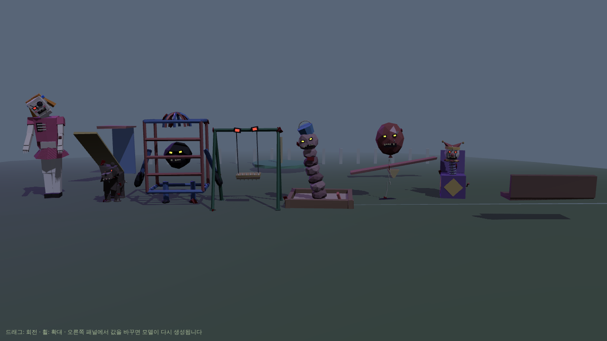
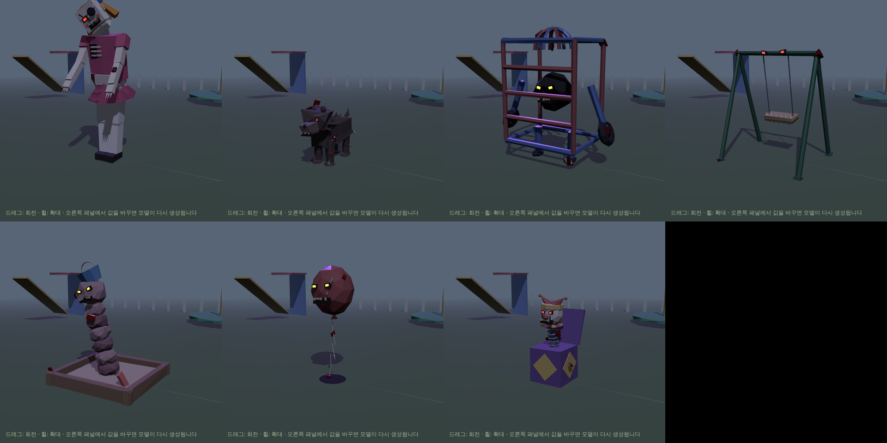
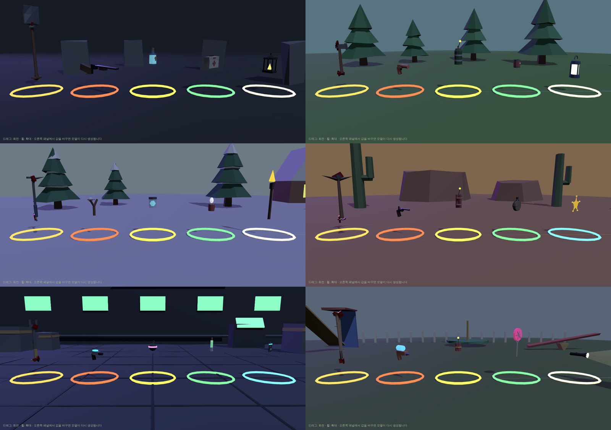
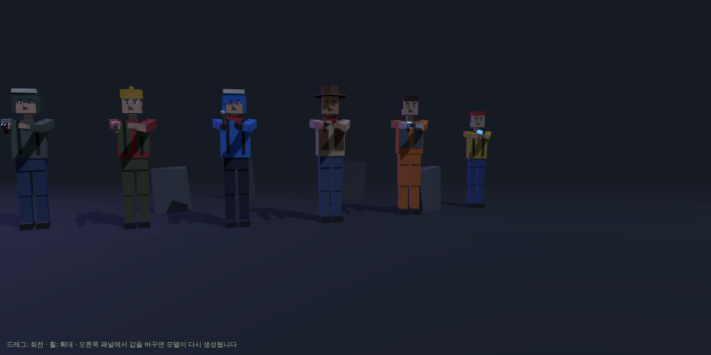
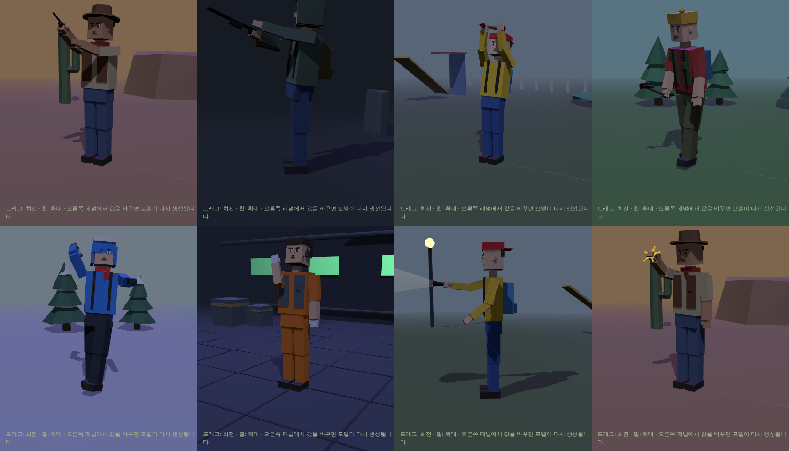
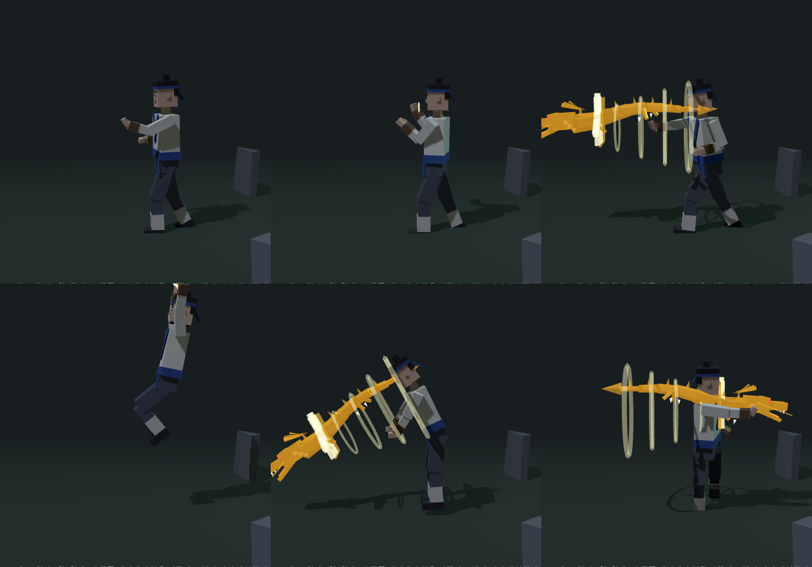
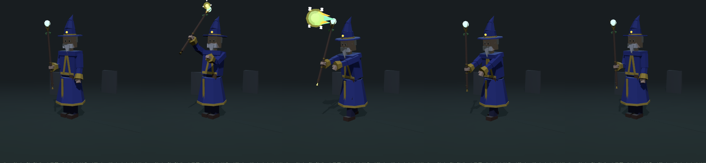

# Parametric Monsters 👾

Polyfork 스타일의 **파라미터형 로우폴리 괴물** 모음입니다. 괴물은 고정된 메시가 아니라 작은 프로그램이라서 값을 바꾸면 그 자리에서 다시 만들어지고, 애니메이션도 코드로 만들어집니다. 좀비 프로젝트(Unity)에서 쓰는 것이 목표입니다. 전체 계획은 [PLAN.md](PLAN.md)에 있습니다.









## 테마
| 테마 | 괴물 (역할 ①~⑦) |
|---|---|
| 🏕️ 숲속 캠핑장 | 늪지 덩이 · 늑대 · 대장곰 · 텐트 미믹 · 호수 장어 · 포자 버섯 · 모닥불 도깨비 |
| ❄️ 눈 내리는 마을 | 눈사람 · 서리 여우 · 설인 · 고드름 거미 · 눈 속 상어 · 폭탄 눈덩이 · 눈보라 요정 |
| 🤠 사막 마을 | 해골 카우보이 · 좀비 코요테 · 선인장 골렘 · 방울뱀 · 모래 벌레 · 회전초 괴물 · 유령 보안관 |
| 🚀 우주 기지 | 감염된 우주인 · 외계 벌레 · 폭주한 경비 로봇 · 변신 슬라임 · 환풍구 촉수 · 산성 알 · 지휘 드론 |
| 🛝 동네 놀이터 | 고장 난 인형 · 광견 들개 · 정글짐 골렘 · 그네 미믹 · 모래밭 벌레 · 풍선 괴물 · 오르골 광대 상자 |
| 🏘️ 동네 골목 (백업) | 마네킹 · 광견 들개 · 쓰레기통 골렘 · 그림자 고양이 · 하수구 악어 · 풍선 괴물 · 확성기 로봇 |

### 플레이어 아이템
테마마다 근접 무기 · 원거리 무기 · 투척 · 회복 · 조명/특수 5종 (총 30종). 뷰어에서 **종류 → 플레이어 아이템**으로 봅니다. 목록은 [PLAN.md](PLAN.md)에 있습니다.
| 🪦 묘지 | 워커 · 러너 · 브루트 · 부패한 좀비 · 크롤러 · 블로터 · 스크리머 |


**공포도** 슬라이더(0 귀여움 ~ 1 무서움, 기본 0.9)로 모든 괴물의 분위기를 한 번에 바꿉니다. 0.75 이상은 처음 만든 좀비와 같은 스타일(사각 눈구멍에 빛나는 눈, 빠진 이빨, 핏자국과 뼈, 울퉁불퉁한 표면)이고, 낮추면 으스스한 카툰 → 귀여운 버전이 됩니다. GLB 내보내기에도 적용되며 `models/`의 파일은 0.9로 만든 것입니다.

### 플레이어 캐릭터
좀비와 같은 박스형 로우폴리 생존자. 테마별 의상 6종(생존자 · 캠퍼 · 등산가 · 레인저 · 기지 정비사 · 동네 아이)과 모든 스테이지용 **치유 마법사** · **무협 고수**가 같은 뼈대와 애니메이션 25개를 씁니다. 뷰어의 **종류 → 플레이어 캐릭터**에서 보고, **들고 있는 아이템**으로 현재 테마 아이템을 손에 쥐어 볼 수 있습니다(아이템에 맞는 애니메이션으로 자동 전환).

| 구분 | 클립 |
|---|---|
| 기본 | `idle` `walk` `run` `hit` `death` `pickup` |
| 총 | `aimPistol` `shootPistol` `walkAimPistol` (한손 총) · `aimRifle` `shootRifle` `walkAimRifle` (양손 총, 펌프 동작 포함) |
| 근접 | `meleeSwing` (한손 내려치기) · `meleeHeavy` (양손 머리 위에서 내려찍기) |
| 기타 | `throw` (던지기) · `useHeal` (마시기·먹기) · `holdLight` (불빛 비추며 둘러보기) · `useSpecial` (배지·카드 들어 보이기) |
| 무공 | `martialIdle` (기마 자세) · `palmKangLong` 항룡유회 · `palmFeiLong` 비룡재천 · `palmShenLong` 신룡파미 |
| 마법 | `holdStaff` (지팡이 들고 대기) · `walkStaff` (지팡이 짚으며 걷기) · `castFireball` (지팡이를 들어 힘을 모은 뒤 앞으로 내밀어 발사) |

### 무협 고수 🐉 · 항룡십팔장


상투머리에 머리띠, 교령(여밈) 저고리 · 허리띠 · 손목 보호대 · 각반 차림의 무협 고수(`models/player/martialHero.glb`). 맨손으로 항룡십팔장(降龍十八掌)을 씁니다.

김용 『사조영웅전』 12회 「항룡유회」에서 홍칠공이 가르치는 장법을 바탕으로 했습니다.
- **항룡유회 亢龍有悔** `palmKangLong`: 소설의 자세 그대로 왼다리를 살짝 굽히고, 오른팔을 안으로 굽혀 오른손바닥으로 원을 한 번 그린 뒤 곧게 밀어냅니다. 힘을 끝까지 다 쓰지 않고 남겨 두는 것(「悔」)이 핵심이라, 미는 팔이 끝까지 뻗기 직전에 멈추고 하체는 버틴 채로 남습니다.
- **비룡재천 飛龍在天** `palmFeiLong`: 뛰어올라 공중에서 두 손바닥으로 앞 아래를 내려칩니다.
- **신룡파미 神龍擺尾** `palmShenLong`: 몸을 꼬리처럼 휘돌려 뒤쪽 적을 칩니다.
- **장력** `models/wuxia/dragonPalm.glb`: 소설에서 항룡장은 소나무를 꺾을 만큼 강하고 맹렬한 *장풍*(손바닥의 힘)으로 묘사되고, 눈에 보이는 용은 나오지 않습니다. 금빛 용은 드라마·만화 각색처럼 게임 연출로 넣은 것이고, `dragon` 옵션을 끄면 손바닥 자국과 바람 고리만 남습니다. 클립 `charge` · `fly` · `impact`.
- 게임에서([`unity/MartialArts.cs`](unity/MartialArts.cs), [`unity/DragonPalm.cs`](unity/DragonPalm.cs)): 장력이 앞으로 돌진하며 지나가는 괴물을 모두 한 번씩 치고(`TakeDamage`) 밀쳐낸 뒤(`Knockback`), 사거리 끝이나 벽에서 터집니다. 발사 시점과 방향은 `items.json`의 `wuxia.dragonPalm.skills`에 있습니다.
- 18초식 중 나머지 15초식은 같은 방식으로 클립을 추가하면 됩니다.

### 치유 마법사 ✨


로브 · 마법사 모자 · 흰 수염 차림의 마법사(`models/player/wizard.glb`). 어느 스테이지에서나 쓰도록 테마에 묶지 않았습니다.

- **치유의 지팡이** `models/magic/items/healingStaff.glb`: 오른손 `gripR`에 붙이는 지팡이. 끝의 `orb`가 시전할 때 빛나고, 그 앞의 빈 노드 `castPoint`가 파이어볼이 나오는 위치입니다.
- **치유 파이어볼** `models/magic/healingFireball.glb`: 금빛 불꽃과 초록 치유 빛이 섞인 공에 `+` 십자가 돌아갑니다. 클립 `fly` (날아가기, 반복) · `charge` (커지기) · `impact` (터지며 빛 고리와 십자가가 퍼짐). +Z 방향으로 날아갑니다.
- 게임에서의 동작([`unity/HealingFireball.cs`](unity/HealingFireball.cs)): 앞으로 날아가다 무언가에 맞으면 터지고, 반경 안의 **괴물은 피해**(`TakeDamage`), **플레이어는 회복**(`Heal`, 시전자 포함 여부 선택)합니다.
- `castFireball`의 55% 지점(`items.json`의 `releaseTime`)에서 파이어볼이 나갑니다. 뷰어에서 마법사를 고르면 지팡이를 들고 파이어볼이 날아가는 모습까지 보입니다.

아이템마다 어떤 클립을 쓰는지는 [`models/items.json`](models/items.json)에 있습니다 (`playerHold` 들고 서 있을 때, `playerUse` 사용할 때, `playerMove` 들고 걸을 때).

## 실행
[Node.js](https://nodejs.org)(LTS)를 설치한 뒤:
```bash
npm install
npm run dev      # 브라우저에서 http://localhost:5173
```
오른쪽 패널: **테마 → 괴물 → 애니메이션**을 고르고, **테마 전체 보기**로 7종을 한 번에 봅니다. ⭐ 표시가 Unity로 내보내지는 표준 클립입니다.

### 배경 키트 (선택)
Polyfork 키트 GLB를 `public/kits/`에 넣으면 테마를 고를 때 자동으로 불러옵니다 (없으면 간단한 대체 배경). 파일 이름은 [PLAN.md](PLAN.md) 표를 따르세요. 크기·높이는 패널의 "배경 키트"에서 맞춥니다. 키트 파일은 크기 때문에 git에 올리지 않습니다.

## Unity에서 쓰기
괴물: `models/<테마>/<괴물>.glb`, 아이템: `models/<테마>/items/<아이템>.glb`, 플레이어: `models/player/<의상>.glb` (각 50~250KB)
1. Package Manager에서 **glTFast**(`com.unity.cloud.gltfast`)를 설치합니다.
2. GLB를 `Assets`에 끌어 넣습니다. Inspector의 **Animation Method**를 `Legacy`로 두면 아래 스크립트로 바로 재생, `Mecanim`으로 바꾸면 Animator Controller에서 클립을 씁니다.
3. 괴물 프리팹에 [`unity/MonsterAnimations.cs`](unity/MonsterAnimations.cs)를 붙이고 `Move()`, `Attack()`, `Hit()`, `Die()`를 호출합니다.
4. 아이템 프리팹에는 [`unity/PlayerItem.cs`](unity/PlayerItem.cs)를 붙이고 `playerHold/playerUse/playerMove`에 `items.json` 값을 넣습니다. 아이템은 `item` 노드의 원점이 손잡이라서 손에 붙이고 위치를 0으로 두면 됩니다. 줍고 나면 `pickupRing`은 꺼집니다.
5. 플레이어 프리팹에는 [`unity/PlayerAnimations.cs`](unity/PlayerAnimations.cs)를 붙입니다. 이동 코드에서 매 프레임 `SetSpeed(속도)`, 아이템을 주우면 `Equip(아이템)`(오른손 `gripR`에 붙음), 사용할 때 `Use()`, 맞으면 `Hit()`, 죽으면 `Die()`. 쏘기·휘두르기 같은 동작은 상체에만 재생돼서 걸으면서도 쓸 수 있습니다.
6. 마법사: 지팡이의 `PlayerItem`에 `playerHold=holdStaff`, `playerUse=castFireball`, `playerMove=walkStaff`를 넣고, `healingFireball.glb`에 [`unity/HealingFireball.cs`](unity/HealingFireball.cs)를 붙여 만든 프리팹을 **Projectile Prefab**에 넣습니다. `Use()`를 부르면 시전 동작 중 `castPoint`에서 파이어볼이 발사됩니다. 괴물에는 `Monster` 태그와 `TakeDamage(float)`, 플레이어에는 `Player` 태그와 `Heal(float)` 메서드가 있으면 됩니다.
7. 무협 고수: `PlayerAnimations`의 **Empty Hand Idle**을 `martialIdle`로 두고, [`unity/MartialArts.cs`](unity/MartialArts.cs)를 붙여 `dragonPalm.glb`+[`DragonPalm.cs`](unity/DragonPalm.cs) 프리팹을 **Palm Prefab**에 넣습니다. `KangLong()` · `FeiLong()` · `ShenLong()`을 부르면 전신 동작과 함께 오른손에서 장력이 나갑니다.

| 클립 | 재생 방식 |
|---|---|
| `idle`, `move` | 반복 |
| `attack`, `special` | 한 번 (스크립트가 끝나면 idle/move로 복귀) |
| `hit` | 한 번 |
| `death` | 한 번, 마지막 자세 유지 |

모델은 +Z를 바라보고 1 단위 = 1 m입니다. 관절은 일반 Transform 애니메이션(스킨 없음)이라 가볍습니다.

## 구조
```
src/core/kit.js        로우폴리 메쉬·눈·입 도우미, 시드 RNG
src/core/monster.js    기본 자세 저장, 애니메이션 재생/굽기, 관절별 메쉬 합치기
src/rigs/              biped(2족) · quadruped(4족) · serpent(마디형) + 각 공용 애니메이션
src/core/item.js       아이템 공통 구조(바닥 빛 고리, 손잡이 원점, idle/use 애니메이션, 플레이어 클립 매핑)
src/player/            플레이어 캐릭터(의상 8종)와 애니메이션 25개
src/magic/             치유의 지팡이 · 치유 파이어볼 (모든 스테이지 공용)
src/wuxia/             항룡장 장력 이펙트와 초식별 발사 설정
src/themes/<테마>/      괴물 정의(monsters.js), 아이템(items.js), 배경 설정(index.js)
unity/                 Unity용 스크립트 (괴물 애니메이션, 아이템 줍기/사용, 플레이어 애니메이션, 치유 파이어볼, 무공)
```

### 새 괴물 추가
테마 폴더의 괴물 정의에 `defaults`(파라미터), `schema`(패널 표시), `build(params)`를 만들고, `build`의 끝에서 `finalizeMonster(root, { rig, params, animations, clips })`를 호출합니다. `clips`에 표준 클립 이름(`idle`, `move`, …)과 애니메이션 키를 짝지으면 GUI와 GLB에 자동으로 들어갑니다.
