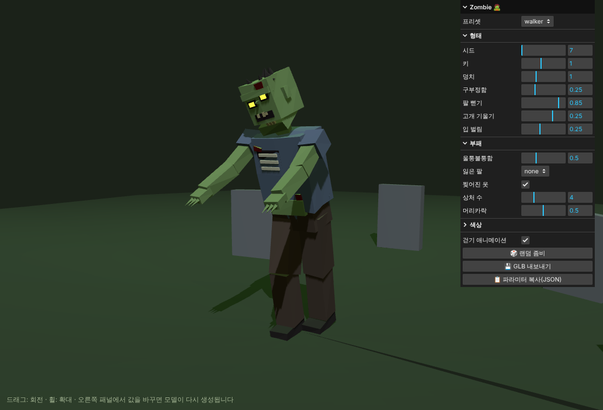
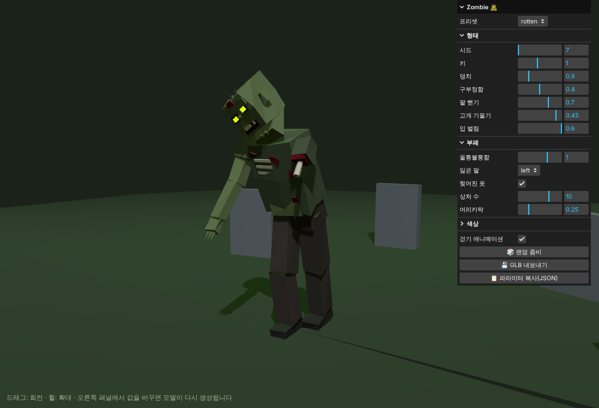

# Parametric Zombie 🧟

Polyfork 스타일의 **파라미터형 로우폴리 좀비** 모델입니다. 모델이 고정된 메시가 아니라 작은 프로그램(`src/zombie.js`)이라서, 값을 바꾸면 모델이 그 자리에서 다시 생성됩니다.



## 실행

```bash
npm install
npm run dev      # http://localhost:5173
```

오른쪽 패널에서 할 수 있는 것:
- **프리셋**: walker / brute / runner / rotten
- **형태**: 시드, 키, 덩치, 구부정함, 팔 뻗기, 고개 기울기, 입 벌림
- **부패**: 울퉁불퉁함, 잃은 팔(left/right), 찢어진 옷, 상처 수, 머리카락
- **색상**: 피부, 셔츠, 바지, 머리, 피, 눈(발광 세기 포함)
- **걷기 애니메이션** 켜기/끄기, **랜덤 좀비**, **GLB 내보내기**, **파라미터 JSON 복사**

`models/zombie-walker.glb`는 기본값(walker, seed 7)으로 내보낸 예시 파일입니다. Blender, Unity, Godot 등에서 바로 열 수 있습니다.

## 코드에서 사용하기 (three.js / R3F)

```js
import { createZombie, setPose, PRESETS } from './src/zombie.js';

const zombie = createZombie({ ...PRESETS.brute, seed: 42, skinColor: '#6a8f4f' });
scene.add(zombie);

// 매 프레임: 비틀거리는 걷기 동작 (amount 0 = 기본 자세)
setPose(zombie, clock.getElapsedTime(), 1);
```

뼈대 역할을 하는 피벗(`hips`, `spine`, `head`, `jaw`, `legL/R`, `kneeL/R`, `armL/R`, `elbowL/R`)은 `zombie.userData.rig`에 들어 있어서 직접 포즈를 잡을 수도 있습니다.


