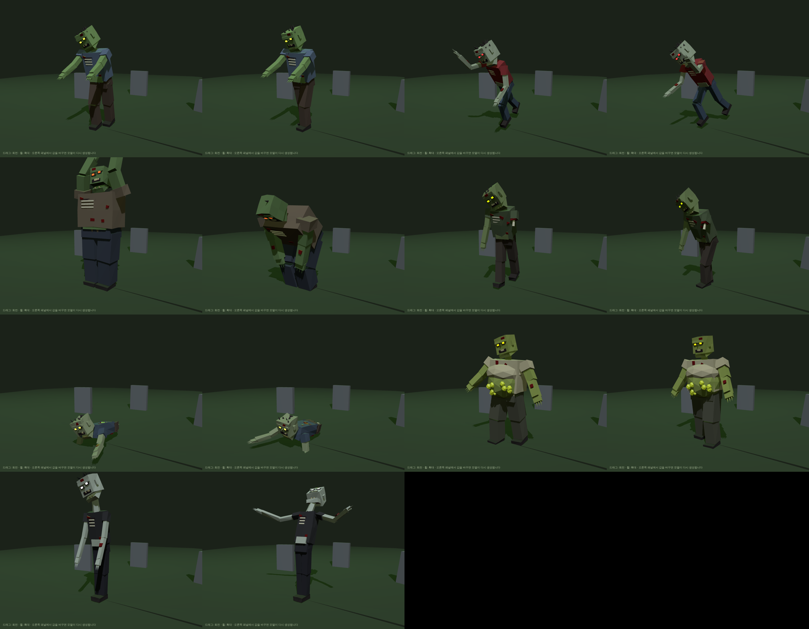

# Parametric Zombies 🧟

Polyfork 스타일의 **파라미터형 로우폴리 좀비** 모음입니다. 모델이 고정된 메시가 아니라 작은 프로그램(`src/zombie.js`)이라서, 값을 바꾸면 모델이 그 자리에서 다시 생성됩니다. 애니메이션도 코드(`src/animations.js`)로 만들어져 있습니다.


## 좀비 종류와 애니메이션

| 종류 | 특징 | 고유 애니메이션 |
|---|---|---|
| `walker` | 기본 좀비, 팔을 앞으로 뻗음 | `shamble` 비틀비틀 걷기 |
| `runner` | 마르고 빠름, 빨간 눈 | `sprint` 전력 질주 (팔 휘두르기) |
| `brute` | 거대한 덩치, 긴 팔 | `smash` 양손 들어 내려찍기 |
| `rotten` | 심하게 부패, 한쪽 팔 없음 | `lurch` 한쪽 다리 끌며 절뚝 + 고개 경련 |
| `crawler` | 하반신 없음, 끌리는 척추 | `crawl` 팔로 땅을 짚고 기어가기 |
| `bloater` | 고름 물집이 난 부푼 배 | `waddle` 뒤뚱뒤뚱 + 배 출렁임 |
| `screamer` | 긴 목, 긴 팔, 창백한 피부 | `scream` 숨 들이쉬고 팔 벌려 비명 + 몸 떨림 |

공통 애니메이션 `idle`(숨쉬기·경련)을 포함해 총 8개이고, 어떤 좀비에든 아무 애니메이션이나 적용할 수 있습니다. 모든 애니메이션은 끊김 없이 반복(loop)됩니다.



## 실행

```bash
npm install
npm run dev      # http://localhost:5173
```

오른쪽 패널:
- **좀비 종류 / 애니메이션 / 재생 / 속도**
- **전체 갤러리 보기**: 7종이 각자의 애니메이션으로 동시에 움직입니다
- **형태**: 시드, 키, 덩치, 구부정함, 팔 뻗기, 팔 길이, 목 길이, 부푼 배, 다리 유무, 고개 기울기, 입 벌림
- **부패**: 울퉁불퉁함, 잃은 팔, 찢어진 옷, 상처 수, 머리카락
- **색상**: 피부, 셔츠, 바지, 머리, 피, 눈(발광 세기)
- **랜덤 좀비**, **GLB 내보내기(애니메이션 포함)**, **파라미터 JSON 복사**

## GLB 파일

`models/zombie-<종류>.glb` 7개가 들어 있습니다. 각 파일에는 **8개 애니메이션 클립**이 모두 들어 있고, 그 좀비의 고유 애니메이션이 첫 번째 클립입니다. Blender, Unity, Godot, three.js 등에서 바로 재생할 수 있습니다.

```js
// three.js에서 GLB 재생
const gltf = await new GLTFLoader().loadAsync('models/zombie-brute.glb');
scene.add(gltf.scene);
const mixer = new THREE.AnimationMixer(gltf.scene);
mixer.clipAction(THREE.AnimationClip.findByName(gltf.animations, 'smash')).play();
// 매 프레임: mixer.update(delta);
```

## 코드에서 직접 사용하기

```js
import { createZombie, setPose, bakeClips, PRESETS } from './src/zombie.js';

const zombie = createZombie({ ...PRESETS.bloater, seed: 42, skinColor: '#6a8f4f' });
scene.add(zombie);

// 매 프레임: 자기 고유 애니메이션 재생 (다른 걸 쓰려면 세 번째 인자에 'scream' 등)
setPose(zombie, elapsedSeconds);

// 또는 AnimationClip으로 구워서 AnimationMixer 사용
const clips = bakeClips(zombie);
```

관절 피벗(`hips`, `spine`, `belly`, `neck`, `head`, `jaw`, `legL/R`, `kneeL/R`, `armL/R`, `elbowL/R`)은 `zombie.userData.rig`에 들어 있습니다.

### 새 애니메이션 추가하기

`src/animations.js`의 `ANIMATIONS`에 항목을 추가하면 GUI와 GLB 내보내기에 자동으로 포함됩니다.

```js
wave: {
  label: '손 흔들기',
  duration: 1.5, // 한 루프 길이(초)
  apply(rig, u) { // u: 0..1, 기본 자세 위에 회전을 더함
    rig.arms.R.shoulder.rotation.z -= 2.5;
    rig.arms.R.elbow.rotation.z = Math.sin(u * Math.PI * 2) * 0.5;
  },
},
```
