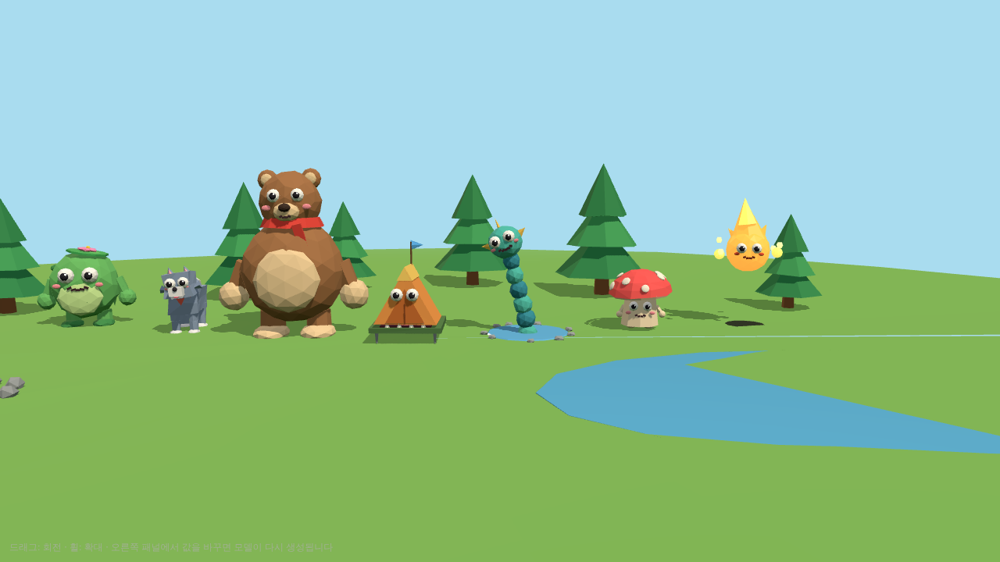
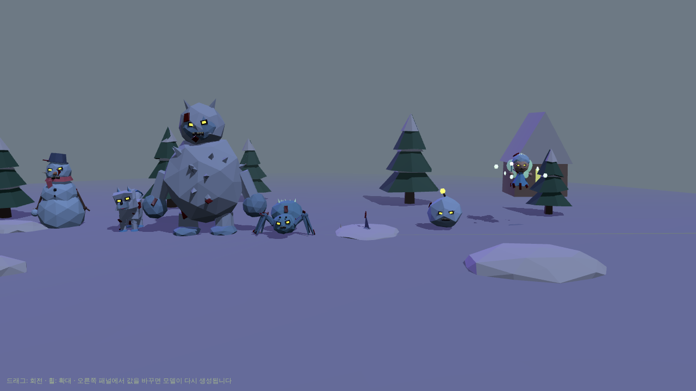
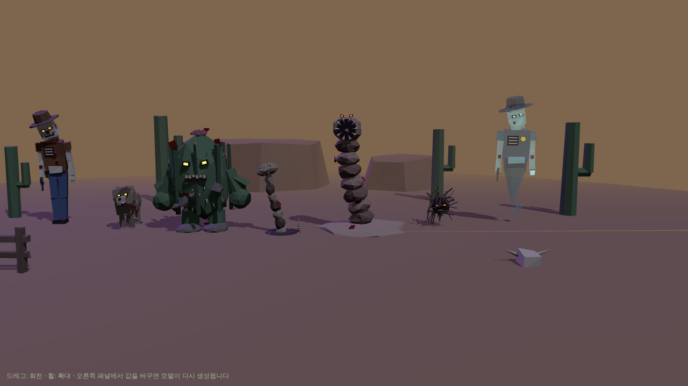
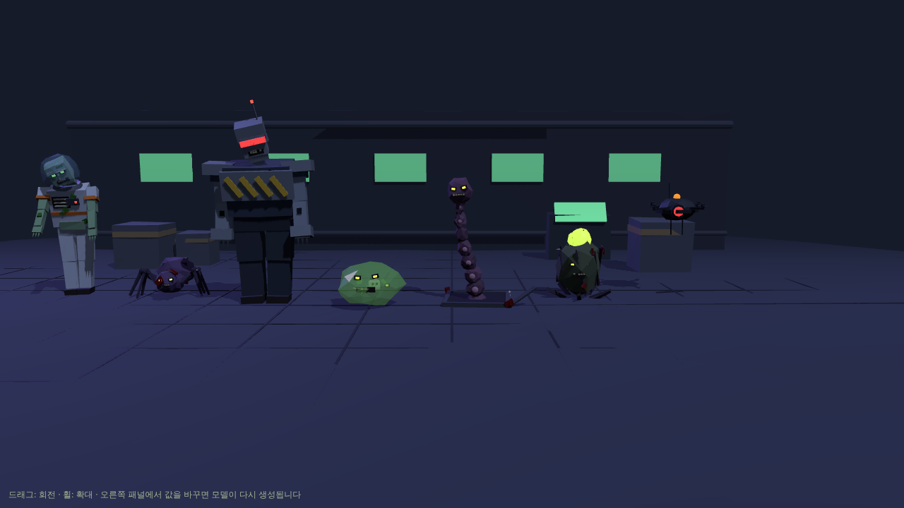
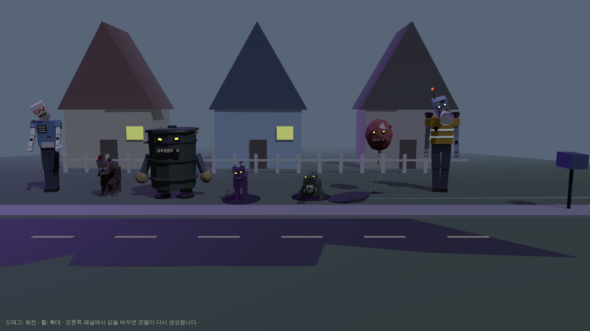
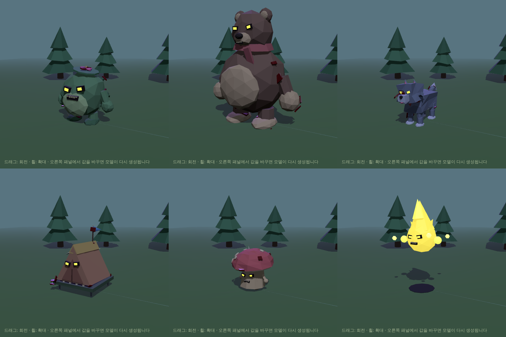
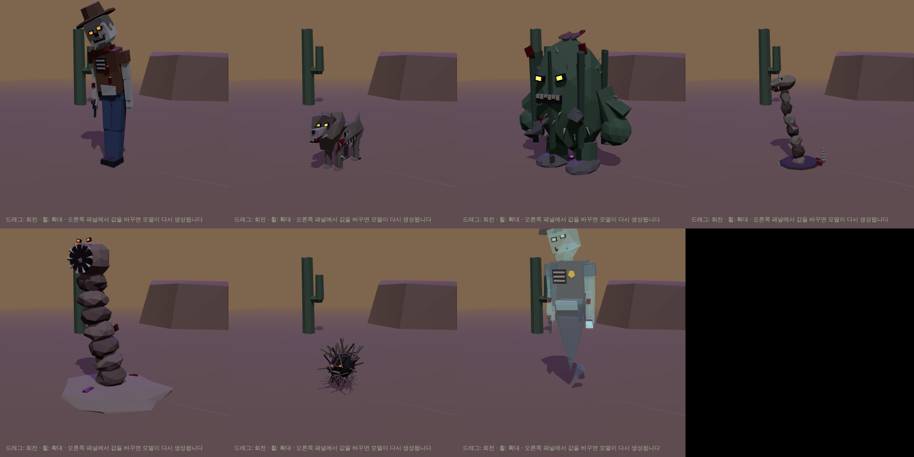
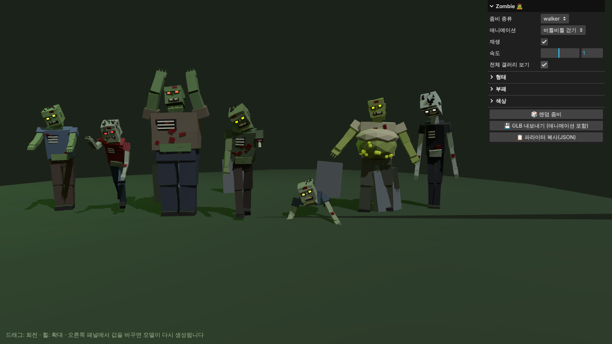

# Parametric Monsters 👾

Polyfork 스타일의 **파라미터형 로우폴리 괴물** 모음입니다. 괴물은 고정된 메시가 아니라 작은 프로그램이라서 값을 바꾸면 그 자리에서 다시 만들어지고, 애니메이션도 코드로 만들어집니다. 좀비 프로젝트(Unity)에서 쓰는 것이 목표입니다. 전체 계획은 [PLAN.md](PLAN.md)에 있습니다.










## 테마
| 테마 | 괴물 (역할 ①~⑦) |
|---|---|
| 🏕️ 숲속 캠핑장 | 늪지 덩이 · 늑대 · 대장곰 · 텐트 미믹 · 호수 장어 · 포자 버섯 · 모닥불 도깨비 |
| ❄️ 눈 내리는 마을 | 눈사람 · 서리 여우 · 설인 · 고드름 거미 · 눈 속 상어 · 폭탄 눈덩이 · 눈보라 요정 |
| 🤠 사막 마을 | 해골 카우보이 · 좀비 코요테 · 선인장 골렘 · 방울뱀 · 모래 벌레 · 회전초 괴물 · 유령 보안관 |
| 🚀 우주 기지 | 감염된 우주인 · 외계 벌레 · 폭주한 경비 로봇 · 변신 슬라임 · 환풍구 촉수 · 산성 알 · 지휘 드론 |
| 🏘️ 동네 골목 | 마네킹 · 광견 들개 · 쓰레기통 골렘 · 그림자 고양이 · 하수구 악어 · 풍선 괴물 · 확성기 로봇 |
| 🪦 묘지 | 워커 · 러너 · 브루트 · 부패한 좀비 · 크롤러 · 블로터 · 스크리머 |


**공포도** 슬라이더(0 귀여움 ~ 1 무서움, 기본 0.9)로 모든 괴물의 분위기를 한 번에 바꿉니다. 0.75 이상은 처음 만든 좀비와 같은 스타일(사각 눈구멍에 빛나는 눈, 빠진 이빨, 핏자국과 뼈, 울퉁불퉁한 표면)이고, 낮추면 으스스한 카툰 → 귀여운 버전이 됩니다. GLB 내보내기에도 적용되며 `models/`의 파일은 0.9로 만든 것입니다.

## 실행
[Node.js](https://nodejs.org)(LTS)를 설치한 뒤:
```bash
npm install
npm run dev      # 브라우저에서 http://localhost:5173
```
오른쪽 패널: **테마 → 괴물 → 애니메이션**을 고르고, **테마 전체 보기**로 7종을 한 번에 봅니다. ⭐ 표시가 Unity로 내보내지는 표준 클립입니다.

### 배경 키트 (선택)
Polyfork 키트 GLB를 `public/kits/`에 넣으면 테마를 고를 때 자동으로 불러옵니다 (없으면 간단한 대체 배경). 파일 이름은 [PLAN.md](PLAN.md) 표를 따르세요. 크기·높이는 패널의 "배경 키트"에서 맞춥니다. 키트 파일은 크기 때문에 git에 올리지 않습니다.

## Unity에서 쓰기
`models/<테마>/<괴물>.glb` (각 100~200KB)
1. Package Manager에서 **glTFast**(`com.unity.cloud.gltfast`)를 설치합니다.
2. GLB를 `Assets`에 끌어 넣습니다. Inspector의 **Animation Method**를 `Legacy`로 두면 아래 스크립트로 바로 재생, `Mecanim`으로 바꾸면 Animator Controller에서 클립을 씁니다.
3. 프리팹에 [`unity/MonsterAnimations.cs`](unity/MonsterAnimations.cs)를 붙이고 `Move()`, `Attack()`, `Hit()`, `Die()`를 호출합니다.

| 클립 | 재생 방식 |
|---|---|
| `idle`, `move` | 반복 |
| `attack`, `special` | 한 번 (스크립트가 끝나면 idle/move로 복귀) |
| `hit` | 한 번 |
| `death` | 한 번, 마지막 자세 유지 |

모델은 +Z를 바라보고 1 단위 = 1 m입니다. 관절은 일반 Transform 애니메이션(스킨 없음)이라 가볍습니다.

## 구조
```
src/core/kit.js        로우폴리 메쉬·눈·입 도우미, 시드 RNG
src/core/monster.js    기본 자세 저장, 애니메이션 재생/굽기, 관절별 메쉬 합치기
src/rigs/              biped(2족) · quadruped(4족) · serpent(마디형) + 각 공용 애니메이션
src/themes/<테마>/      괴물 정의(파라미터·GUI 스키마·빌드 함수·클립 매핑)와 배경 설정
unity/                 Unity용 재생 스크립트
```

### 새 괴물 추가
테마 폴더의 괴물 정의에 `defaults`(파라미터), `schema`(패널 표시), `build(params)`를 만들고, `build`의 끝에서 `finalizeMonster(root, { rig, params, animations, clips })`를 호출합니다. `clips`에 표준 클립 이름(`idle`, `move`, …)과 애니메이션 키를 짝지으면 GUI와 GLB에 자동으로 들어갑니다.
