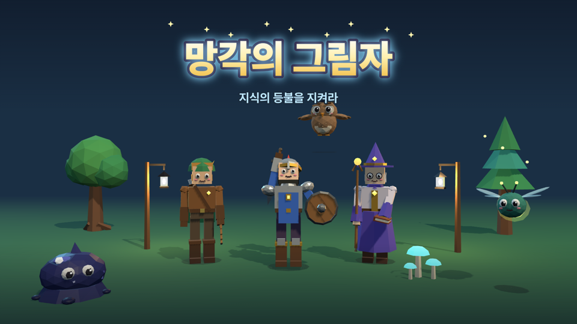
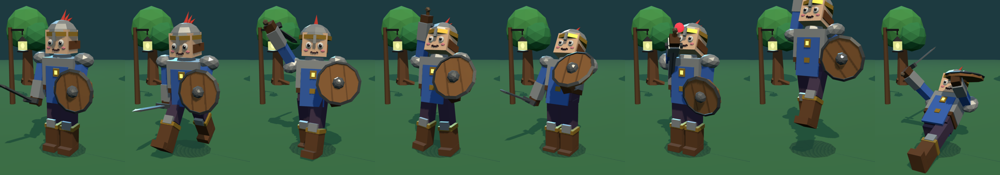
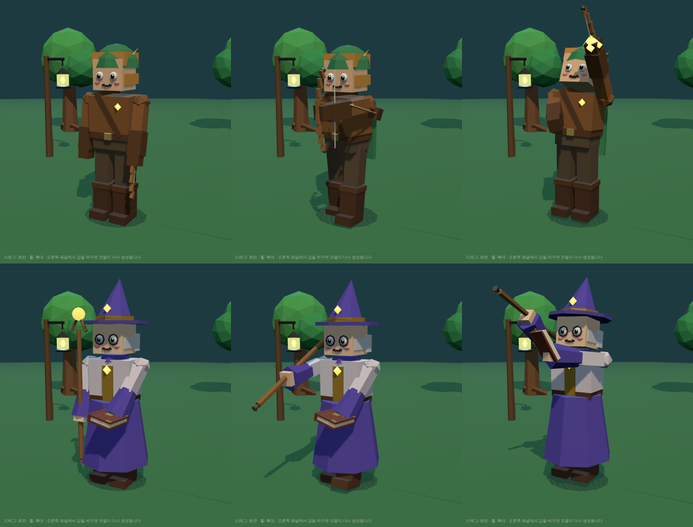
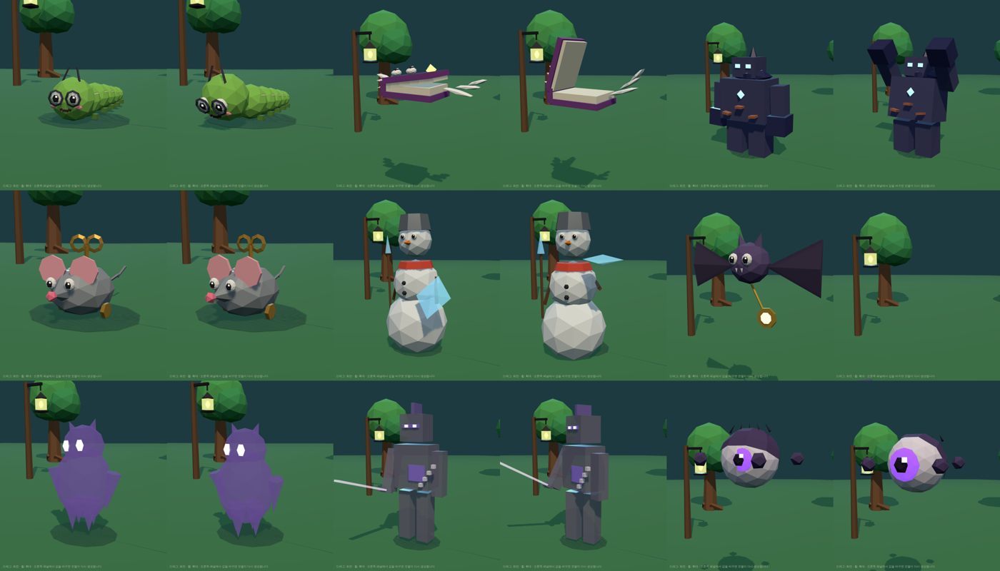
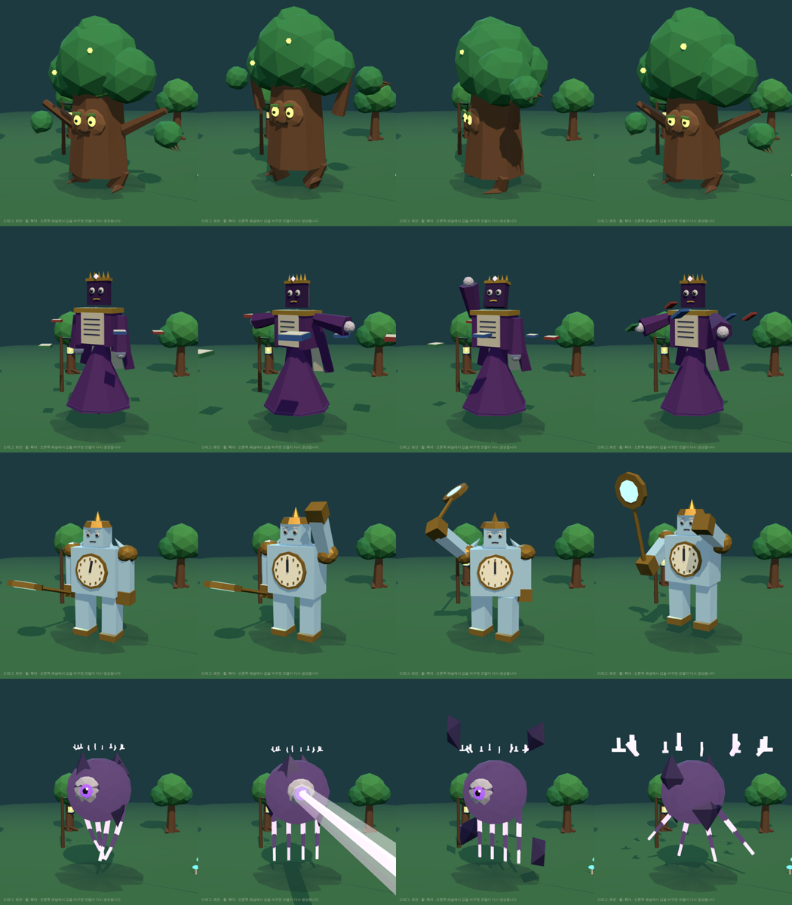
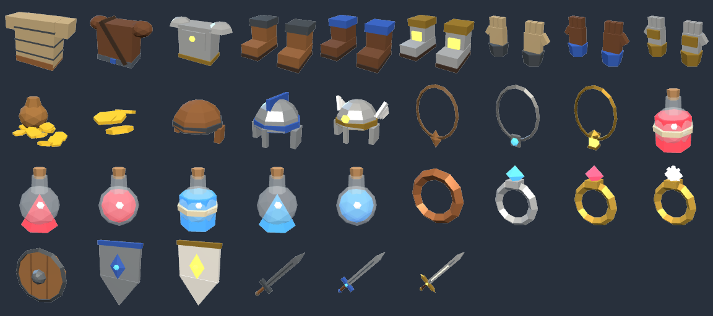
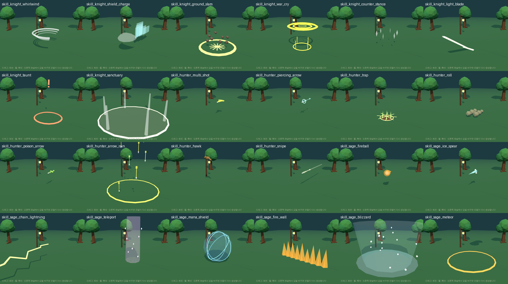
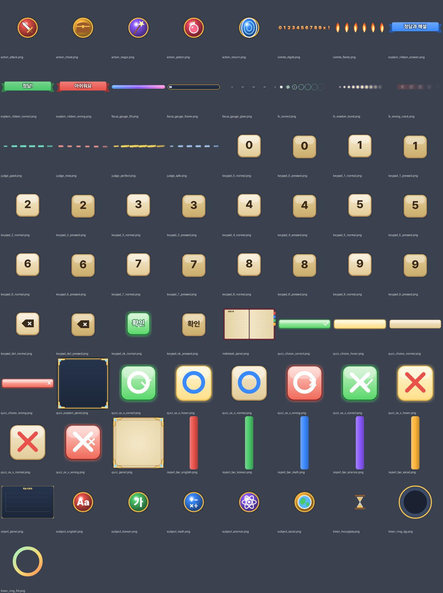
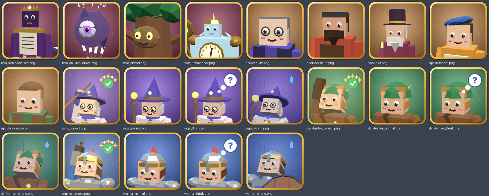

# 망각의 그림자: 전체 에셋 (교육용 핵앤슬래시 ARPG)

에셋 제작 목록(1~9절)의 에셋을 코드로 만들었다. 스테이지 타일셋과 마을 건물은 직접 만들지 않고 Polyfork 키트를 쓰기로 했다([추천 목록](#스테이지-polyfork-키트)).

- 규격: 1 unit = 1 m = 던전 1칸, 정면 +Z, 단색 flat shading.
- 고어 없음: 쓰러지면 빛 조각과 글자 파편으로 흩어진다.
- 쓰는 법: `public/` 폴더를 게임 저장소에 그대로 복사하면 문서의 파일 이름 규칙대로 들어간다.
- 라이선스: 모델·UI·사운드는 모두 이 저장소의 코드로 직접 생성한 오리지널이다. 폰트만 외부 것(SIL OFL)이다. 자세한 내용은 [CREDITS.md](CREDITS.md)에 있다.



## 한눈에 보기

| 분류 | 개수 | 위치 |
|---|---|---|
| 플레이어 클래스 3종 (클립 8개씩) | 3 | `models/characters/` |
| NPC 5명 + 부엉이 루미 | 6 | `models/characters/` |
| 일반 몬스터 12종 + 투사체 2종 | 14 | `models/monsters/` |
| 보스 4종 | 4 | `models/monsters/b0*.glb` |
| 아이템 (장비·소모품·퀴즈 도구·바닥 드랍·전설 12종) | 73 | `models/items/` + `icons/items/*.png` |
| 숲 타일셋 (MVP 때 만든 것, Polyfork로 대체 가능) | 35 | `models/props/` |
| 효과 (공용·보스·상태 이상·포탈·엘리트 오라·기본 투사체) | 29 | `models/vfx/` |
| 스킬 (클래스당 8개) + 스킬 아이콘 48·96px | 24 | `models/vfx/skills/` + `icons/skills/` |
| UI·퀴즈 UI PNG | 131 | `ui/quiz/`, `ui/hud/`, `ui/title/` |
| 초상화·카드·타이틀·로딩 화면·스킬 아이콘 | 88 | `ui/portraits/`, `ui/select/`, `ui/mascot/`, `ui/loading/`, `icons/skills/` |
| 효과음 | 60 | `audio/sfx/` |
| BGM·징글 | 11 | `audio/bgm/` |
| 폰트 (Pretendard, Galmuri11) | 6 | `fonts/` |

GLB는 모두 188개다. 목록 파일은 세 가지다.

- [`manifest.json`](manifest.json): 모델마다 파일, 삼각형 수, 클립(길이·반복 여부), 부품 이름, 조명, 아이콘 경로.
- [`ui-manifest.json`](ui-manifest.json): UI 이미지마다 크기, 9-slice 여백, 프레임 수, 용도.
- [`audio-manifest.json`](audio-manifest.json): 소리마다 파일, 길이, 반복 여부.

## 캐릭터



### 클래스 3종

| 클래스 | 파일 | 무기 | 삼각형 |
|---|---|---|---|
| 수호기사 | `warrior.glb` | `weapon`(검, armR) + `shield`(방패, armL) | 1,670 |
| 별사냥꾼 | `star_hunter.glb` | `weapon`(활, **armL**). 쏠 때만 보이는 `arrow`(armR), 등의 `quiver` | 1,396 |
| 현자 | `sage.glb` | `weapon`(지팡이, armR) + `offhand`(마법서, armL) | 1,594 |

- 공통 부품: `torso`, `head`, `armL`, `armR`, `legL`, `legR`, `potion`(마실 때만 보임), `fragments`(쓰러질 때).
- 공통 클립: `idle`, `walk`, `attack`, `cast`, `hit`, `death`, `drink`, `victory`.
- 판정 타이밍(클립 길이에 대한 비율):

| 동작 | 타이밍 |
|---|---|
| 기사 `attack` | 0.5에 칼이 닿는다 |
| 사냥꾼 `attack` | 0.55에 화살이 나간다 (`vfx/fx_arrow.glb`) |
| 현자 `attack`·`cast` | 0.5에 마법이 나간다 (`vfx/fx_magic_bolt.glb`) |

- 장비 바꾸기: `weapon`/`shield`/`offhand` 그룹 안을 비우고, 아이템 GLB의 `item` 노드를 위치·회전 0으로 넣는다.
  - 검·지팡이·활: 손잡이가 원점이고 +Y 방향이다.
  - 방패: 앞면이 +Z 방향이다.

### NPC와 루미

| 대상 | 클립 | 비고 |
|---|---|---|
| NPC (`npc_merchant`, `npc_blacksmith`, `npc_storekeeper`, `npc_archivist`, `npc_chief`) | `idle`, `talk`, `wave` | 오른손에 `prop` (돈주머니, 망치, 열쇠 꾸러미, 장부, 등불 지팡이) |
| 부엉이 루미 (`mascot_lumi.glb`) | `idle`, `fly`, 표정 `face_default`, `face_think`, `face_happy`, `face_sad`, `face_surprised`, `face_cheer` | 퀴즈 결과에 맞춰 표정 클립을 튼다 |

## 몬스터


| 지역 | 몬스터 (파일) | 특수 클립 |
|---|---|---|
| 숲 | 잉크 슬라임 `m01`, 가시 도토리병사 `m02`, 반딧불 정령 `m03` (+ 빛 구슬 `m03_firefly_orb`) | |
| 도서관 | 책벌레 애벌레 `m04`, 날개 달린 마법서 `m05` (+ 페이지 `m05_grimoire_page`), 잉크 골렘 `m06` | |
| 시계탑 | 태엽 쥐 `m07`, 눈사람 경비병 `m08` (얼음 방패), 시계추 박쥐 `m09` (급강하) | |
| 심연 | 그림자 메아리 `m10`, 지워진 기사 `m11`, 망각의 눈 `m12` | `m10` `teleport`, `m11` `flicker`, `m12` 레이저 `attack`(0.35~0.8 동안 `beam`) + `summon` |

- 공통 클립: `idle`, `walk`(나는 몬스터는 `fly`), `attack`, `hit`, `death`, `spawn`.
- 모든 몬스터에 `body` 피벗이 있다. 문서의 부품 이름(`blob`/`eyes`, `nut`/`head`, `core`/`wingL`/`wingR` 등)도 들어 있다.
- 삼각형은 모두 1.5k 이하다.

### 엘리트
새 모델 없이 일반 몬스터에 `vfx/fx_elite_*.glb`(반복 재생)를 붙인다.
- `giant`(거대화)는 몬스터를 1.5배로 키운다.
- `haste` 신속, `fire` 화염 오라, `frost` 냉기, `split` 분열 표시, `shield` 보호막.

### 보스


| 보스 | 파일 | 패턴 | 전용 효과 |
|---|---|---|---|
| 고목 수호자 올드루트 | `b01_oldroot` | 뿌리 내려찍기, 도토리병사 소환, 회전 가지 | `fx_boss_root_spike` |
| 금서의 군주 | `b02_forbidden_lord` | 페이지 폭풍, 잉크 웅덩이, 마법서 소환 | `fx_boss_page_storm`, `fx_boss_ink_pool` |
| 얼어붙은 시간지기 | `b03_time_keeper` | 시간 정지, 시계추 휘두르기, 얼음 내려찍기 | `fx_boss_time_zone` |
| 망각의 근원 (3페이즈) | `b04_oblivion_source` | 광선, 그림자 가시, 망각의 눈 소환, 글자 폭풍 | `fx_boss_shadow_spikes` |

- 클립: `intro`, `idle`, `walk`, `attack1`~`attack3`(최종 보스는 `attack4`까지), `phase`, `hit`, `death`.
- 최종 보스는 2→3페이즈 전환 `phase3`이 있다. 이 클립에서 껍질이 깨져 날아간다.
- 패턴별 타격 시점은 `manifest.json`의 각 보스 `timing`에 있다.
- 보스 체력바 초상화: `ui/portraits/boss_*.png`.

## 아이템


- 장비:
  - 한손검·양손검·방패·투구·갑옷·장갑·신발·지팡이·활: 3단계씩.
  - 석궁·마법서·허리띠: 2단계씩.
  - 반지 4단계, 목걸이 3단계.
- 소모품:
  - 체력·마나 물약 소·중·대, 회복의 샘물, 귀환·감정 두루마리, 열쇠, 골드 2종.
  - 퀴즈 도구: 힌트 깃털, 시간의 모래시계, 두 번째 기회 부적.
- 바닥 드랍 공용 모델 6종(`drop_*`): 감정 전 꾸러미.
- 전설 전용 12종(`legend_*`): 새벽별 검, 지혜의 방패, 망각을 가르는 대검, 올드루트의 활, 시간지기의 지팡이, 봉인 풀린 금서, 루미의 깃털 투구, 등불 수호 갑옷, 촛불 장갑, 바람 장화, 별빛 반지, 기억의 목걸이.
- 등급 표시:
  - 아이콘 뒤 `ui/hud/slot_<등급>.png` (전설은 `slot_legendary_glow.png` 8프레임).
  - 툴팁 `ui/hud/tooltip_<등급>.png`.
  - 바닥 빛 기둥 `vfx/fx_loot_beam_<등급>.glb`.

## 스킬과 효과


| 클래스 | 스킬 8개 (`vfx/skills/skill_<클래스>_<id>.glb`) |
|---|---|
| 수호기사 | whirlwind 회전베기, shield_charge 방패 돌진, ground_slam 대지 강타, war_cry 수호의 함성, counter_stance 반격 태세, light_blade 빛의 검, taunt 도발, sanctuary 성역 |
| 별사냥꾼 | multi_shot 다중 사격, piercing_arrow 관통 화살, trap 덫 설치, roll 구르기, poison_arrow 독화살, arrow_rain 화살비, hawk 매 소환, snipe 저격 |
| 현자 | fireball 화염구, ice_spear 얼음 창, chain_lightning 연쇄 번개, teleport 순간이동, mana_shield 마나 보호막, fire_wall 화염 벽, blizzard 눈보라, meteor 유성 |

- 스킬마다 `cast` 클립(발밑 마법진)이 있다. 그다음은 종류에 따라 다르다.

| 종류 | 클립 | 쓰는 법 |
|---|---|---|
| 투사체 | `fly`(반복) + `impact` | 게임 코드가 +Z로 날린다 |
| 범위·근접·이동 | `play` | 맞는 지점에 생성한다 |
| 버프 | `play` (반복) | 캐릭터를 따라다니게 한다 |

- 종류와 색은 `manifest.json`에 있다.
- 스킬 아이콘: `icons/skills/<이름>.png`(48px), `@2x.png`(96px).
- 공용 효과:
  - 타격, 치명타, 소멸, 레벨업, 물약 회복 2종, 빛 기둥 4색, 클릭 표시.
  - 상태 이상 `fx_status_burn` / `freeze` / `poison` / `stun`.
  - 마을 포탈 `fx_portal`.

## UI (PNG)



- 9-slice 이미지는 `ui-manifest.json`의 `slice: [위, 오른쪽, 아래, 왼쪽]` 여백으로 늘린다.
- 애니메이션 이미지는 가로 스트립이다. `frames`가 칸 수다.

### 퀴즈 UI (`ui/quiz/`)

| 에셋 | 파일 |
|---|---|
| 퀴즈 패널 (양피지) | `quiz_panel` |
| 보기 버튼 4상태 | `quiz_choice_*` |
| O·X 버튼 4상태 | `quiz_ox_*` |
| 숫자 키패드 (0~9, 지우기, 확인) | `keypad_*` |
| 원형 타이머 | `timer_*` |
| 행동 종류 아이콘 5종 | `action_*` |
| 판정 텍스트 6프레임 | `judge_*` |
| 정답 이펙트 8프레임 | `fx_correct` |
| 오답 이펙트 6프레임 | `fx_wrong_crack` |
| 콤보 숫자·불꽃 | `combo_*` |
| 집중 게이지 | `focus_gauge_*` |
| 지혜 폭발 12프레임 | `fx_wisdom_burst` |
| 해설 창 | `quiz_explain_panel`, `explain_ribbon_*` |
| 오답노트 | `notebook_panel` |
| 학습 리포트 | `report_panel`, `report_bar_*` |
| 과목 아이콘 | `subject_*` |

### HUD·창 (`ui/hud/`)

| 에셋 | 파일 |
|---|---|
| 체력·마나 구슬 | `orb_*` |
| 경험치 바 | `exp_bar_*` |
| 스킬·물약 칸 | `skill_slot`, `potion_slot`, `skill_cooldown` |
| 몬스터 체력바 3종 | `monster_hp_*` |
| 공용 패널·제목 띠 | `panel_dark`, `panel_title` |
| 인벤토리 칸·등급 배경 | `slot_*` |
| 장비 실루엣 10종 | `equip_*` |
| 툴팁 4등급 | `tooltip_*` |
| 공용 버튼 4상태 | `button_*` |
| 미니맵 틀·아이콘 | `minimap_*` |
| 커서 4종 | `cursor_*` |
| 데미지 숫자 비트맵 폰트 4색 (0~9, +, !) | `damage_digits_*` |

### 화면
- 타이틀: `ui/title/logo.png`, `title_background.png`, `title_screen.png`.
- 캐릭터 선택: `ui/select/card_*.png`(400×600), `art_*.png`(1024).
- 로딩 화면 5종: `ui/loading/` (마을, 숲, 도서관, 시계탑, 심연).
- 초상화 (`ui/portraits/`):
  - 클래스마다 `normal`, `think`, `correct`, `wrong` 4장.
  - NPC 5명, 보스 4종.
- 루미 표정 6장: `ui/mascot/`.

### 폰트 (`fonts/`)
- Pretendard: 본문·퀴즈용. Regular, Bold, ExtraBold, Black.
- Galmuri11: 픽셀 UI용. Regular, Bold.
- 둘 다 SIL OFL 1.1이고, 라이선스 파일이 함께 들어 있다.

## 사운드 (`audio/`)
- 효과음 60개 (`sfx_*.ogg`):

| 분류 | 효과음 |
|---|---|
| 퀴즈 | 팝업, 선택, 정답, 오답, 퍼펙트, 째깍, 시간 초과, 콤보, 지혜 폭발 |
| 전투 | 휘두르기, 타격 3종, 치명타, 화살, 원소 시전 3종, 착탄, 방패 막기 |
| 플레이어 | 발소리 3종, 피격, 쓰러짐, 레벨업, 물약 |
| 몬스터 | 몬스터 소리, 보스 소리 |
| 아이템 | 드랍 4등급, 줍기, 장착, 골드, 이동 |
| UI | 클릭, 올리기, 열기, 닫기, 오류, 퀘스트 완료 |
| 환경 | 상자, 문, 잠금 해제, 계단, 포탈, 항아리 |
| 스킬 | 스킬 소리 7개 |

- BGM 11곡 (`bgm_*.ogg`):
  - 타이틀, 마을, 지역 4곡, 보스, 최종 보스, 퀴즈 대기 루프: 반복 재생용.
  - 승리·게임 오버 징글.
- 샘플 없이 코드(`tools/audio/synth.py`)로 합성한 칩튠풍 소리다.
- **직접 들어 보지는 못했다.** 음량(최대 −2 dB 정도)과 스펙트럼만 확인했으니, 귀로 들어 보고 마음에 안 드는 소리는 알려 주세요.

## three.js 예시
```js
const gltf = await new GLTFLoader().loadAsync('/models/monsters/m01_inkslime.glb');
const mixer = new THREE.AnimationMixer(gltf.scene);
const clip = (name) => mixer.clipAction(THREE.AnimationClip.findByName(gltf.animations, name));
clip('walk').play();
const a = clip('death'); a.setLoop(THREE.LoopOnce); a.clampWhenFinished = true; a.reset().play();
mixer.update(dt); // 매 프레임
```
- 조명 소품과 계단에는 `lightPoint` 노드가 있다. `manifest.json`의 `light` 값으로 그 자리에 PointLight를 붙인다.

## 스테이지: Polyfork 키트
아래는 검색 결과 기준이다. 실제 부품 목록과 가격은 https://polyfork.dev/kits 에서 확인한다.

| 지역 | 추천 |
|---|---|
| 등불 마을 | Medieval Village Kit |
| 속삭이는 숲 | Nature & Forest Kit |
| 무너진 대도서관 | 전용 키트 없음. Bookshelf, Library Book Stack 등 개별 에셋 + 던전 키트를 갈색·금색으로 |
| 얼어붙은 시계탑 | Alpine and Snow Kit + Ice Chunk, Whimsical Gear Hub |
| 망각의 심연 | Dungeon & Crypt Kit를 보라·검정으로. 뼈 같은 고어 에셋은 빼기 |

## 다시 만들기
1. `npm install`
2. `npx vite build && npx vite preview --port 4173 &`
3. 아래 명령을 저장소 루트에서 실행한다. 노드 스크립트(`.cjs`)는 루트로 복사해서 실행해야 `playwright`를 찾는다.

```bash
cp tools/edu-export.cjs _e.cjs && node _e.cjs models/edu; rm _e.cjs   # GLB·아이템 아이콘·manifest
node tools/ui/ui-gen.cjs models/edu                                   # UI·퀴즈 UI PNG
node tools/ui/art-gen.cjs models/edu                                  # 초상화·카드·스킬 아이콘·타이틀·로딩
python3 tools/audio/synth.py models/edu                               # 효과음·BGM
```

- 원본 코드:
  - 모델: `src/edu/`
  - UI 그리기: `tools/ui/gen.js`, `tools/ui/art.js`
  - 사운드: `tools/audio/synth.py`
- 뷰어: **테마 → [교육 ARPG] 속삭이는 숲**을 고른 뒤 **종류**에서 캐릭터·보스·스킬 등을 고른다.
