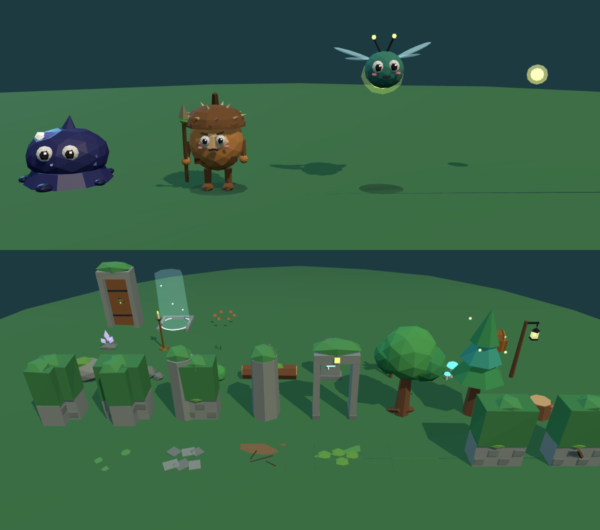

# 망각의 그림자: MVP 3D 에셋 (교육용 핵앤슬래시 ARPG)

에셋 제작 목록의 **10.1 MVP 최소 에셋** 가운데 3D로 만들 수 있는 것을 모두 만들었다. 공통 규격(1절)에 맞췄다.

- 1 unit = 1 m = 던전 1칸, 정면 +Z
- 단색 flat shading, 텍스처 없음
- 피·고어 없음. 쓰러지면 빛 조각과 글자 파편으로 흩어진다.
- `public/` 폴더를 게임 저장소에 그대로 복사하면 문서의 파일 이름 규칙과 같은 위치에 들어간다.




## 들어 있는 것 (GLB 84개 + 아이콘 33장)

| 폴더 | 내용 | 삼각형 |
|---|---|---|
| `characters/` | `warrior` 수호기사 (키 1.6 m) | 1,670 (규격 2k) |
| `monsters/` | `m01_inkslime` 잉크 슬라임, `m02_acornsoldier` 가시 도토리병사, `m03_firefly` 반딧불 정령, `m03_firefly_orb` 빛 구슬 투사체 | 1,453~1,492 (규격 1.5k) |
| `items/` | 한손검·방패·투구·갑옷·장갑·신발 각 3단계, 반지 4단계, 목걸이 3단계, 체력·마나 물약 소·중·대, 골드 소량·다량 (33종) | 84~464 (규격 500) |
| `props/` | 속삭이는 숲 바닥 6, 벽 7, 소품·조명 13, 바닥 장식 5, 상호작용 4 (35종) | 36~320 |
| `vfx/` | 타격 스파크, 치명타, 몬스터 소멸, 레벨업, 물약 회복(체력·마나), 아이템 빛 기둥 4색, 클릭 표시 | 68~460 |
| `icons/items/` | 아이템 아이콘 128×128 PNG (투명 배경) | |

[`manifest.json`](manifest.json)에는 파일마다 다음 정보가 들어 있다.
- 파일 경로
- 삼각형 수
- 클립 이름, 길이(초), 반복 여부
- 움직이는 부품 이름
- 조명 위치·색·범위
- 아이콘 경로

## 부품 이름 (코드로 애니메이션할 때)
관절 위치에 피벗이 있다.

| 대상 | 부품 그룹 |
|---|---|
| 수호기사 | `torso`, `head`, `armL`, `armR`, `legL`, `legR`, `weapon`(armR 자식), `shield`(armL 자식). 추가로 `potion`(마실 때만 보임), `fragments`(쓰러질 때) |
| 잉크 슬라임 | `blob`, `eyes` (+ `splash`, `spawnRing`, `fragments`) |
| 도토리병사 | `nut`(몸), `head`(가시 모자), `legL`, `legR`, `armR`(> `spear`), `armL` |
| 반딧불 정령 | `core`, `wingL`, `wingR` (+ `lamp` 꼬리 빛, `charge` 모이는 빛) |

- 문서의 "도토리병사형" 규칙(`nut`, `head`, `legL`, `legR`, `armR`)에서 `head`는 도토리 모자로 해석했다. 얼굴은 `nut`에 있다.
- 다리는 `torso`가 아니라 루트의 자식이다.
- `weapon`, `shield` 그룹은 기본 상태에서 안쪽 메시가 정면을 보도록 이미 회전되어 있다.

## 장비 바꾸기
1. `weapon` 그룹 안의 메시를 지운다.
2. 아이템 GLB의 `item` 노드를 그 안에 넣는다.
3. `item`의 위치·회전을 0으로 둔다.

- 검은 손잡이가 원점이고 칼날이 +Y 방향이다.
- 방패는 손잡이가 원점이고 앞면이 +Z 방향이다.
- 문서의 팁대로 투구·갑옷·장갑·신발은 아이콘과 바닥 드랍용이고, 캐릭터 외형은 바뀌지 않는다.

## 클립 (GLB 안에 구워 둠, 30 fps)
문서는 애니메이션을 코드로 만든다고 했지만, 같은 동작을 GLB 클립으로도 넣어 두었다. 코드 애니메이션을 쓸 때는 무시해도 된다.

| 대상 | 클립 |
|---|---|
| 수호기사 | `idle` `walk` `attack` `cast` `hit` `death` `drink` `victory` |
| 몬스터 | `idle` `walk`(정령은 `fly`) `attack` `hit` `death` `spawn` |
| 빛 구슬 | `charge` `fly` `impact` |
| 보물상자 | `idle` `open` `opened` |
| 잠긴 문 | `idle` `open` |
| 항아리 | `break` |
| 계단·조명·나무 | `idle` (반복) |
| 아이템 | `idle` (바닥에서 둥실 회전) |
| 효과 | `play` (빛 기둥만 반복) |

### 타이밍
- 수호기사 `attack`: 0.6초 클립의 50% 지점(0.3초)에 칼이 닿는다. 판정 타이밍으로 쓴다.
- 반딧불 정령 `attack`: 45% 지점(0.4초)에 빛 구슬을 쏜다.
  - `m03_firefly_orb`를 정령 위치에 만들어 +Z로 날린다.
  - 구슬은 GLB 안에서 정령의 입 높이(1.0 m)에 올라가 있다.

### 상태 표현 (클립 안에 들어 있음)
- `death`: 몸이 줄어들며 사라지고 빛 조각과 글자 파편이 흩어진다.
- `spawn`: 발밑의 빛 고리에서 솟아오른다.

## three.js 예시
```js
const gltf = await new GLTFLoader().loadAsync('/models/monsters/m01_inkslime.glb');
const mixer = new THREE.AnimationMixer(gltf.scene);
const clip = (name) => mixer.clipAction(THREE.AnimationClip.findByName(gltf.animations, name));
clip('walk').play();
// 한 번만 재생하는 동작(attack, hit, death, spawn, open, break, play)
const a = clip('death');
a.setLoop(THREE.LoopOnce);
a.clampWhenFinished = true;
a.reset().play();
// 매 프레임
mixer.update(dt);
```

- 조명 소품(`stage1_lantern_post`, `stage1_mushroom_glow`, `stage1_crystal`, `stage1_candle_stand`, `stage1_stairs_down`)에는 `lightPoint` 노드가 있다.
  - `manifest.json`의 `light` 값(색, 세기, 범위)으로 그 자리에 PointLight를 붙인다.
  - 크롬북에서는 PointLight를 몇 개로 제한하고, 나머지는 빛나는 재질만으로 충분하다.
- 바닥 타일은 윗면이 y = 0이다. 벽은 칸 중앙을 지나는 중심선 방식이다.
  - 직선 벽은 X축 방향이다.
  - 모서리 벽은 +X와 +Z 방향 팔이고, T자 벽은 −X, +X, +Z 방향이다.
  - 끝 벽은 +X 방향 팔이다.
  - Y축으로 90°씩 돌려 쓴다. 중심선 방식이라 안·밖 모서리는 같은 조각을 돌려 쓴다.

## 이번에 만들지 않은 것
- 3D가 아닌 에셋: 퀴즈 UI, HUD, 초상화, 일러스트, 폰트, BGM, 효과음.
- P1 이후 에셋: 다른 클래스, 지역 2~4, 보스, 엘리트 오라, NPC, 마스코트.
- 숲의 배경(어둠·안개): 엔진의 fog와 배경색으로 처리하는 편이 가볍다.

## 다시 만들기·수정
- 원본은 이 저장소의 `src/edu/`에 있다.
- 뷰어(`npm run dev`)에서 **테마 → [교육 ARPG] 속삭이는 숲**을 고르고, **종류**에서 괴물·아이템·캐릭터·타일·효과를 고른다.
- 색과 크기 슬라이더를 바꾸면 그 자리에서 다시 만들어진다.
- 라이선스: 이 저장소의 코드로 직접 생성한 오리지널 모델이다. 외부 에셋을 쓰지 않았으므로 `assets/CREDITS.md`에는 "직접 제작"으로 적으면 된다.
